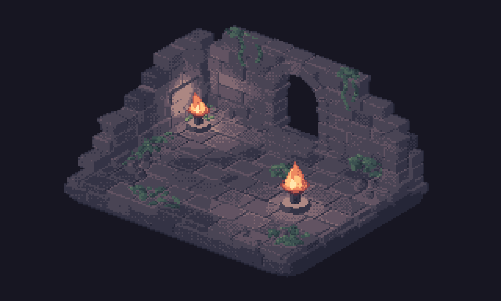

# 黑暗森林像素风格规范

本规范用于场景、美术资产和渲染的设计与评审。暮林石室是当前的风格基准场景。

## 画面要求

- **保留像素化渲染。** 放大后，像素边缘保持清楚，色块内部保持均匀。当前预览用最近邻放大低分辨率渲染结果。
- **默认使用纯深色底。** 画面重点由场景内的轮廓、材质和局部光源建立。远景和水面反射按场景单独决定是否加入。
- **镜头、分辨率和具体色值随场景调整。** 暮林石室的正交斜俯视、`320 × 192` 原始画面和现有色板是对照样例。

## 暮林石室的做法

石头用低饱和的灰紫色，苔藓用暗绿，火焰用暖橙。墙、地砖和道具的亮部集中在火盆附近，远处仍能看清拱门、残墙和地砖的大轮廓。背景色是 `#171622`。

| 材质 | 当前色阶，由暗到亮 |
| --- | --- |
| 石头 | `#252637` `#343345` `#494454` `#625362` `#816871` `#ac8782` |
| 苔藓 | `#222d35` `#2d3c42` `#3b5050` `#4a6258` `#637764` `#89946a` |
| 火盆与火焰 | `#512e3d` `#84424a` `#be5b50` `#ee8960` `#ffc581` `#ffe4ab` |

墙和道具由火盆中的 `PointLight` 照亮。地砖上的光斑以火盆为中心，沿地面从内到外分三档，转动镜头时仍贴着原来的石砖。深度描边压暗遮挡边，法线描边提亮部分折角。轻微的 Bayer 抖色只在色阶交界附近形成点纹。

当前渲染先计算照明和描边带来的明暗变化，再加入抖色并从材质色阶取色。材质限色是否作为全项目的验收标准，仍待确认。

## 视觉验收

1. 以正常游玩尺寸查看场景。确认轮廓、主要材质和视觉焦点易于辨认。
2. 放大检查火焰、石墙边缘和地砖缝隙。确认边缘仍由清晰的像素块组成。
3. 场景支持转镜头时，抽查初始视角和至少一个旋转后的视角。用了地面光斑时，确认光斑始终贴着地面。
4. 使用材质限色时，检查亮面、暗面、描边和抖色交界的像素。它们应来自该材质定义的色阶。

渲染流程在 [src/main.js](../src/main.js)，场景资产和火盆位置在 [src/room.js](../src/room.js)，项目用语见 [GLOSSARY.md](../GLOSSARY.md)。
